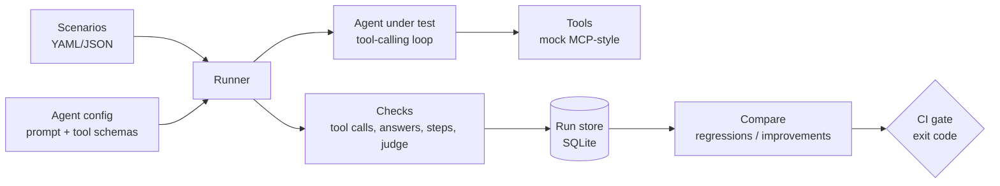

# agent-eval-harness — unit tests for agent configs

A one-line change to a system prompt, an MCP tool description, or an agent
skill can break behavior that worked perfectly yesterday — and nothing in
your test suite notices, because the application code didn't change.

That's the gap this project fills. **agent-eval-harness** lets you define
repeatable test scenarios for an agent setup (prompt + tools + skills), run
them, and **compare runs before and after a change** so regressions are
visible before they reach users. Think of it as unit tests, but for agent
configuration.

It's the same idea behind GitHub's Copilot Evals, rebuilt as a small,
framework-agnostic, open-source harness you can run anywhere — including
in CI.

## The demo (30 seconds)

```bash
pip install -e .
python -m agent_eval_harness demo
```

The demo runs the same 9 scenarios against two configs:

- **v1** — a known-good assistant config (weather, calendar, calculator,
  file search tools).
- **v2** — v1 after a "small cleanup" edit: the weather tool's description
  was rewritten to talk about historical climate records, and the
  "confirm before creating calendar events" rule was trimmed from the
  system prompt.

Result:

```
v1: 9/9 scenarios passed
v2: 4/9 scenarios passed

Summary: 5 regression(s), 0 improvement(s), 0 behavior change(s), 4 unchanged
REGRESSIONS FOUND — the config change broke previously passing scenarios.
```

The compare view names each regression, shows the tool sequence before and
after, and prints the failing checks — so you see *what* broke, not just
*that* something broke. In v2 the agent stops calling the weather tool
(the description no longer describes current conditions) and starts
creating calendar events without asking first. Both are the kind of
breakage that ships silently in real systems.

## How it works



1. **Scenarios** describe a task and what a good run looks like.
2. **The runner** executes each scenario against the agent config,
   recording the transcript, tool calls, latency, and token usage.
3. **Checks** score the run. Every run is stored with a **fingerprint**
   (SHA-256 of the system prompt + tool schemas), so you can always prove
   which config produced which behavior.
4. **Compare** diffs two runs scenario by scenario: regressions
   (pass → fail), improvements, and behavior changes (same outcome,
   different tool sequence — worth a look even when tests still pass).

## Writing scenarios

One YAML file per scenario (or several under a `scenarios:` list):

```yaml
id: weather-basic
name: Basic weather lookup
prompt: "What's the weather in Austin?"
checks:
  - type: tool_called
    tool: get_weather
    args: {city: Austin}
  - type: answer_contains
    text: sunny
  - type: max_steps
    value: 4
```

Supported checks:

| Check | What it asserts |
|---|---|
| `tool_called` | Tool was called (optional `args` matchers, `times`) |
| `tool_not_called` | Tool was never called (`"*"` = no tools at all) |
| `answer_contains` | Final answer contains text (case-insensitive by default) |
| `answer_matches` | Final answer matches a regex |
| `answer_equals` | Final answer equals text (whitespace/case normalized) |
| `max_steps` | Agent finished within N loop steps |
| `llm_judge` | A judge model scores the answer against a `rubric` (live mode only) |

Argument matchers support plain values plus `{contains: x}`, `{regex: x}`,
`{any: true}`, and `{one_of: [...]}`. Scenarios can also restrict the
tools available with an optional `tools: [...]` allowlist.

The bundled pack (`scenarios/`) covers tool selection, argument
correctness, a multi-step request, confirmation-before-write, and
abstention when no tool fits.

## Agent configs

A config is the thing under test — system prompt plus tool schemas:

```yaml
name: assistant-v1
system_prompt: |
  You are a helpful personal assistant...
  Always ask the user to confirm before creating calendar events.
tools:
  - name: get_weather
    description: Get the current weather and forecast for a city...
    parameters:
      city: {type: string, required: true}
      units: {type: string, enum: [metric, imperial], default: metric}
    write: false
```

`write: true` marks tools that mutate state — the kind agents often must
confirm before calling. Tool *implementations* are registered in code
(`tools.py` ships weather/calendar/calculator/file-search stand-ins for
real MCP servers); the config controls what the agent *sees*.

## Running evals

Mock mode (default) is fully offline and deterministic — no API key:

```bash
agent-eval run --scenarios scenarios/ --config configs/v1.yaml
agent-eval list-runs
agent-eval report <run-id>
agent-eval compare <baseline-run-id> <new-run-id>
```

### Live mode (real models, provider-agnostic)

Live mode goes through [LiteLLM](https://docs.litellm.ai/), so the model
is just an env var. Set `LLM_MODEL` and the provider's standard key var:

| Provider | `LLM_MODEL` | Key env var |
|---|---|---|
| Gemini (default) | `gemini/gemini-3.5-flash-lite` | `GEMINI_API_KEY` |
| Groq | `groq/llama-3.3-70b-versatile` | `GROQ_API_KEY` |
| OpenRouter (free models) | `openrouter/meta-llama/llama-3.3-70b-instruct:free` | `OPENROUTER_API_KEY` |
| Ollama (local) | `ollama/llama3.1` | none (local server) |

```bash
export GEMINI_API_KEY=...            # or GROQ_API_KEY / OPENROUTER_API_KEY
export LLM_MODEL=gemini/gemini-3.5-flash-lite   # optional; this is the default
agent-eval run --scenarios scenarios/ --config configs/v1.yaml --live
```

Transient provider errors (429/503) are retried with backoff. The
`llm_judge` check only runs in live mode; in mock mode it's reported as
skipped, never silently passed.

### CI gate

Fail the build when a config change regresses behavior:

```bash
agent-eval run --scenarios scenarios/ --config configs/v2.yaml \
  --baseline <known-good-run-id> --fail-on-regression
# exit code 1 if any scenario regressed vs the baseline
```

## Why this exists

We already run unit and integration tests whenever application code
changes. Agent configurations deserve the same discipline: a prompt
update, a tool schema change, or a new skill can shift tool selection and
execution even when the underlying code is untouched. Repeatable evals
won't eliminate nondeterminism — but they make regressions visible, which
is the difference between catching a bad edit in CI and catching it in a
support ticket.

## Project layout

```
src/agent_eval_harness/
  scenarios.py   load + validate scenario files
  checks.py      check evaluation (tool calls, answers, judge)
  config.py      agent config + fingerprinting
  prompts.py     live-backend prompt scaffolding (action protocol, judge)
  tools.py       mock MCP-style tool implementations
  agent.py       reference agent; mock + LiteLLM backends
  runner.py      execute scenarios, persist runs
  store.py       SQLite run store
  compare.py     run diffing (regressions, improvements, changes)
  report.py      human-readable output
  cli.py         run / compare / list-runs / report / demo
scenarios/       bundled scenario pack (9 scenarios)
configs/         v1 (known-good) and v2 (subtly broken) demo configs
tests/           pytest suite (offline)
```

## Development

```bash
python -m venv .venv && .venv/bin/pip install -e ".[dev]"
.venv/bin/python -m pytest
```

## Limitations

- The reference agent is a small JSON-action loop, not a full framework —
  the harness is the product; bring your own agent by implementing the
  same backend interface.
- Mock mode uses a deterministic rule-based stand-in that routes by tool
  description and follows prompt rules. It proves the pipeline and catches
  config-level breakage; it does not predict a specific real model's
  behavior. Use `--live` for that.
- `llm_judge` scoring is only as good as the judge model and rubric.

## License

MIT
